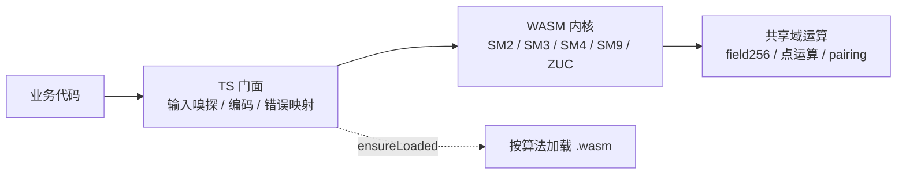

# 国密算法跑进 WebAssembly：实测 SM2 验签快 7 倍、SM4-GCM 快 11 倍，我是怎么做到的

> 如果你做过政务、金融或医疗类的 H5 / 小程序，大概率遇到过这个需求：登录要 SM2 签名，报文要 SM3 摘要，敏感字段要 SM4 加密。
>
> 浏览器原生 `crypto.subtle` 不支持国密，只能找 JS 实现。能跑，但一上量就慢：1 KB 数据 SM4-ECB 要 37 µs，SM2 验签要 2.85 ms（纯 JS 参考实现），低端安卓机和基础库较低的小程序还要再打折。
>
> 换成 C/C++ 或 Rust 的 Node 原生模块？`node-gyp` 这一关就把前端和小程序挡在门外了。
>
> 这篇文章讲我怎么用 AssemblyScript + WebAssembly 解决这个问题：哪些优化真的有效，哪些是自我感动，以及跨 Node / 浏览器 / 小程序时踩过的坑。

---

## 写在前面

这个项目叫 `sm-crypto-wasm`，用 AssemblyScript 写算法核心、编译成 WebAssembly，TypeScript 只做薄薄一层门面。支持 SM2 / SM3 / SM4 / SM9 / ZUC，Node 18+、现代浏览器、Web Worker、微信内置浏览器和小程序都能跑，Apache-2.0。

本文不是 API 文档，也不打算把每个函数列一遍。我想讲三个对前端团队更有用的问题：

1. 为什么前端做国密，最后都会撞上性能墙？
2. 把热点搬进 WASM 之后，哪些优化真的有效？
3. 跨 Node / 浏览器 / 小程序时，工程上要付什么代价？

性能数据的环境：**AMD Ryzen 7 7800X3D / Node 24.15 / Windows 11 / `sm-crypto-wasm` 0.7.1**，命令 `pnpm bench`。不同机器会有差异，文章后面会讲怎么复现，以及为什么我不建议你直接拿跨进程的绝对数字做选型。

先说明一句：这是一个算法实现库，不是经过商用密码产品认证的合规产品。生产环境怎么用、要不要过测评，请按你所在行业的要求来。

---

## 一、前端做国密，为什么总是“能跑但很慢”

典型场景：政务、金融、医疗的 H5 或小程序，登录要 SM2 签名，报文要 SM3 摘要，敏感数据要 SM4 加密。浏览器原生 `crypto.subtle` 不支持国密，所以只能自己实现。

纯 JS 实现能跑，但慢在三个地方：

- **大整数运算**：SM2 的标量乘是 256 位模运算，JS 没有原生定宽整数，只能用 BigInt 或数组模拟。一次验签要做几百次点加、倍点，每次都是分配和进位。
- **S 盒查表**：SM4 每轮 4 次 8-bit S 盒查表，ZUC 的非线性函数 F 也是。成本不在 ALU，在内存访问。
- **跨边界**：如果每次分组都从 JS 调一次 WASM，1 KB 数据要 64 次跨界，胶水层的开销会把内核的收益吃掉。

原生库呢？C/C++ 或 Rust 编译的 Node addon 要 `node-gyp`，浏览器和小程序直接出局；Rust → WASM 是一条路，但要看发布物形态和调用方式（后面会讲我踩过的坑）。

所以目标很明确：**发布物要能直接进前端构建，热点要足够快，API 在 Node / 浏览器 / 小程序里保持一致**。

先看一组对比数字。同机、同参数、同消息，纯 JS 参考实现是 `gmkitx`（这里只做同口径参照，不是竞品评测）：

| 操作 | 纯 JS（gmkitx） | sm-crypto-wasm | 倍数 |
|---|---:|---:|---:|
| SM3 hash 1 KB | 14.7 µs | 4.75 µs | 3.1× |
| SM4 ECB 1 KB | 37.3 µs | 6.98 µs | 5.3× |
| SM4 GCM 1 KB | 221 µs | 19.8 µs | 11.2× |
| SM2 签名 64 B | 446 µs | 142 µs | 3.1× |
| SM2 验签 64 B | 2.85 ms | 402 µs | 7.1× |
| SM2 解密 64 B | 2.59 ms | 343 µs | 7.6× |
| ZUC EEA3 1 KB | 20.5 µs | 9.07 µs | 2.3× |

注意 SM2 那一行。签名只快 3.1×，验签快 7.1×。不是因为算法不同，而是因为验签里的联合标量乘、点运算和模逆更吃 WASM 的定宽整数；签名还包含随机数、编码和门面层开销，占比更高。这个差异后面会解释。

包体积（`dist/<algo>/<algo>.wasm`）：

| 模块 | 大小 |
|---|---:|
| sm2 | 40 KB |
| sm3 | 6.7 KB |
| sm4 | 15 KB |
| sm9 | 77 KB |
| zuc | 6.5 KB |

按算法分包、按需加载，所以只做 SM4 的页面不会下载 `sm9.wasm`。对小程序这种包体积敏感的场景，这一点比“总包多大”更重要。

---

## 二、为什么是 AssemblyScript，而不是 Rust / C++

先说结论：不是 AssemblyScript 比 Rust 好，而是这个项目的约束下，它的取舍更合适。

AssemblyScript 的语法是 TypeScript 的子集，`asc` 直接把它编译成 WASM，不需要 wasm-bindgen、emscripten 那层胶水。带来的好处：

- **发布物简单**：`.wasm` + 薄 TS，用户 `npm install` 就能用，不需要 `node-gyp`、Rust 工具链或交叉编译；
- **包体小**：SM3 6.7 KB、SM4 15 KB，适合浏览器和小程序；
- **前端团队能维护**：算法核心和门面都是 TS 风格，读起来门槛低；
- **类型检查**：`asc` 在编译期能抓掉一批指针、类型错误。

代价也很实在：

- **内存要自己管**：`alloc` / `free` / 永久区 / 临时区，指针范围和重叠规则都得自己保证；一旦越界，WASM 不会给你漂亮的堆栈；
- **没有 Rust 的生态和借用检查**：大整数、曲线、pairing 都得自己写；
- **语言限制**：AS 0.28 不认 `import { type X }`，某些 TS 语法不能用，调试体验也一般；
- **性能上限受代码生成影响**：同样的算法，Rust/LLVM 往往能生成更好的代码，AS 需要更手工的优化。

这个项目选 AS，是因为它要解决的是“**让前端团队能维护、发布物足够小、跨端足够简单**”，而不是“把单次 SM9 验签压到极限”。如果你要做的是服务端高性能密码库，Rust 可能更合适；如果你要做的是 npm 上开箱即用的前端库，AS 的工程收益更大。

这也是我后来做横向对比时反复提醒自己的一点：**语言不是性能结论，构建配置和调用方式才是**。

---

## 三、架构：薄门面 + 厚内核 + 按算法懒加载

整个库分三层：



- **TS 门面**：解析 hex / base64 / PEM / `Uint8Array`，校验长度，把 WASM 的返回码映射成 `SmCryptoError` 子类；
- **WASM 内核**：算法的热路径，尽量少跨边界；
- **共享域运算**：SM2 / SM9 的 256 位模运算、点运算、pairing。

### 异步边界：`ensureLoaded()`

WASM 的实例化是异步的，但业务代码希望加密函数是同步的（否则每个调用点都要 `await`）。所以每个算法命名空间暴露一个 `ensureLoaded()`：

```ts
import { sm3, sm4 } from 'sm-crypto-wasm';

const key = '0123456789abcdeffedcba9876543210';
const iv  = '000102030405060708090a0b0c0d0e0f';

await Promise.all([sm3.ensureLoaded(), sm4.ensureLoaded()]);

sm3.hash('616263');                          // 之后都是同步
sm4.encryptCBC(key, iv, '616263');
```

`ensureLoaded()` 是 memoize 的，并发调用共用同一个 Promise，不会实例化两次。没有做“隐式加载”，因为那会让同步 API 在背后偷偷 `await`，行为不可预测。

### 跨运行时

同一份门面代码，加载器按环境切换：

- **Node 18+**：`fs/promises` 读 `dist/<algo>/<algo>.wasm`；
- **浏览器**：`fetch(new URL('../<algo>/<algo>.wasm', import.meta.url))`；
- **Web Worker**：加载器不依赖 DOM，直接用；
- **微信小程序**：`WXWebAssembly.instantiate(codePackagePath, imports)` + `wx.getRandomValues`。

`package.json` 的 `browser` 字段会把 Node 版 `loadWasm.js` / `random.js` 替换成浏览器版，所以浏览器产物里不会出现 `node:fs`，Webpack / esbuild / Rspack 不会在解析期报错。

这里有一个工程细节值得单独说：**浏览器里 `crypto.getRandomValues` 需要安全上下文**（HTTPS 或 localhost）。拿不到时库会直接抛错，不会退化成 `Math.random`。密码学库里，“不可用”比“悄悄降级”安全。

---

## 四、六个真正影响性能的优化

这一节是全文核心。每个优化按“问题 → 做法 → 数据 → 取舍”讲。

### 4.1 SM4：8 块标量交错，而不是 SIMD

SM4 的瓶颈很明确：每轮 4 次 8-bit S 盒查表。WASM 没有 ARMv8 的 `SM4E`，也没有 AES-NI；`v128` 没有 AVX2 的 gather，`i8x16.swizzle` 只能覆盖 4-bit 表，够不着 SM4 的 8-bit S 盒。

所以 SIMD 这条路走不通。最后的做法是**标量交错**：一次处理 8 个块，每块 4 条独立依赖链，让 CPU 的乱序执行去覆盖 L1 查表延迟；不足 8 块退到 4 块，再不足退到单块。

这不是“向量化”，而是“把串行依赖拆开、让流水线忙起来”。实测 1 KB ECB 6.98 µs，比纯 JS 快 5.3×；GCM 因为多了认证标签的计算（GHASH），19.8 µs，快 11.2×。

代价是代码复杂度和块数不足时的退化。对前端来说，SM4 通常一次处理几十字节到几 KB，8 块交错的收益是实打实的；但如果你只加密 16 字节，它和单块路径差不多。

### 4.2 SM3：把 HMAC 整体下沉进 WASM

SM3 的结构决定了它很难“并行”：MD 链式，块和块之间串行；压缩函数 64 轮也是串行依赖。能做的只有把单块成本压到最低：

- 用裸指针 + `load<u32>` / `store<u32>`，绕开 AS 的边界检查和 GC 写屏障；
- 模块级 scratch，复用 132 个 u32 的工作区，消掉每块的 `new`；
- 轮循环里就地计算 `W'`，不再单独物化一遍；
- 填充缓冲改成模块级复用，只清零真正需要的 padding 区。

更关键的是 **HMAC 整体下沉**。原先 `ipad` / `opad` 拼接和两次摘要调用都在 JS 层，一次 HMAC 要跨 4 次边界、建 3 个临时数组。现在把两段输入接口暴露给 WASM，让 `ipad ‖ msg` 直接参与填充，HMAC 只跨一次边界。

合计：hash 快 26%，hmac 快 45%，1 KB hash 4.75 µs。

这里没有“黑科技”，就是把每一次内存分配、每一次跨界都抠掉。SM3 的结论是**到顶**：在单消息语义下，再优化也只有个位数百分比；真正的加速需要“一次哈希多条独立消息”，而这不是公开 API 的用法。

### 4.3 SM2：固定公钥预计算，1.2 次加密回本

SM2 加密的标量乘部分要做两次：

- `k·G`：G 是固定基点，走 comb 表，52 次倍点；
- `k·P`：P 是对端公钥，走 wNAF，256 次倍点。

在底层 `encryptOut` 里，`k·P` 占了约 **73%** 的时间。而对端公钥在“同一接收方反复加密”的场景里是固定的——比如小程序反复给同一个服务端上报数据。

做法是把 comb 表从固定基点推广到任意点：为公钥预计算 32 项表（260 次倍点 + 31 次点加），之后 `k·P` 从 256 次倍点降到 52 次。表放在 8 个固定槽位里，按 LRU 淘汰，每槽带 64 字节公钥指纹；不命中自动回退 wNAF，不会隐式建表。

```ts
import { sm2 } from 'sm-crypto-wasm';

await sm2.ensureLoaded();
const { privateKeyPem, publicKeyPem } = await sm2.generateKeyPair();

await sm2.preparePublicKey(publicKeyPem);   // 一次性建表，约 280 µs
const ct = sm2.encrypt(publicKeyPem, '616263');
```

实测：64 B 加密 486 → 260 µs（1.86×），建表 280 µs，**约 1.2 次加密回本**；8 把公钥轮换加密和单把命中同档。8 个槽位共占永久区固定 24 KiB，不随调用增长。

取舍：

- 只对“少量固定对端”划算；工作集超过 8 把，会退化成每次 prepare；
- 不做隐式建表，避免外部可控的公钥反复触发 280 µs 的建表；
- 公钥是公开信息，缓存它不引入新的密钥材料驻留。

同一思路还有一个签名点池：固定基点标量乘占单次签名约 56%，`createSignaturePointPool(n)` 把它提前摊销，命中时单次签名从 141 µs 降到 24 µs（5.9×）。点是一次性的，结构上防复用，`k` 不对外暴露。

```ts
const pool = await sm2.createSignaturePointPool(4);  // 按批量大小创建
const sig = sm2.sign(privateKeyPem, '616263', { pointPool: pool });
```

注意池里的点是一次性的：`sign` 每用一次就取走一个，不能跨批次复用；池耗尽后回退到正常的随机 `k` 路径。

### 4.4 SM9：Barrett 归约换 Montgomery 域

SM9 的耗时由 pairing 主导，pairing 的耗时由基域模乘主导。原来 `p` 和 `n` 不是伪 Mersenne 形状，走的是 Barrett 归约：一次 512→256 归约约 217 次 32×32 乘法；换成 CIOS Montgomery 只要 128 次。

做法是把整条曲线搬进 Montgomery 域，只在字节边界和模块级常量上做 `fpToMont` / `fpFromMont`。实测单次模乘 179 → 98 ns，端到端 sign / verify / encrypt / decrypt / KEM / 密钥交换全面快 **1.6–1.8×**。

这里有两个编译器抓不到的坑：

- `fpInv` 少补一个 `R`：`modInv(a·R) = a⁻¹·R⁻¹`，要补回 `a⁻¹·R`，而且必须用标准域乘法乘 `R²`；用 `montMul` 会自带 `·R⁻¹`，正好把要补的 `R` 又消掉。症状是所有点坐标掉出曲线。
- `FE_A2` / `FE_A3` 是指数、不是元素：它们和 `ALPHA1..5` 长得像，但喂给 `fp12Pow` 时必须保持标准域整数，转成 Montgomery 会让最终幂整条错掉。

SM9 在小程序里用得不多，但它是“数学层优化”的典型案例：**先把热点归结到一次模乘，再决定换表示**。如果只盯着上层函数，很容易做一堆无效优化。

### 4.5 跨边界：批量接口与 hex 编解码

WASM 优化不只看内核，边界同样致命。

- **SM4 CFB / OFB 曾经比纯 JS 还慢**：因为这两个模式原先在 TS 侧逐块调用 WASM，1 KB 要 64 次跨界。补上批量导出后降到 10 µs 一带，反过来快 3.6–3.8×。
- **hex 编解码**：改走 `Buffer.toString('hex')`（浏览器回落查表），编码快约 27×；输入侧把“正则校验 + 解析”合并成一趟。两者合计让 hex 入参的 SM3 / SM4 / ZUC 端到端快 27–32%。

这条经验对前端特别重要：**不要在一个循环里反复调用 WASM 导出函数**。能批量的批量，能一次传进去的不要分 64 次传。

### 4.6 一个反例：micro-bench 快 1.19×，端到端是 0

SM9 的平方特化是一个很好的教训。把 `fpSqr` 从 `montMul(a, a)` 改成专门的 Comba 平方 + SOS 归约，单次平方确实快 1.19×（121.5 → 102.5 ns）。但端到端一测，G1 标量乘 +0.8% / +2.1%，pairing −0.9% / −1.5%，净效果约等于零。

原因是热路径里的 `fp12Sqr` / `fp4Sqr` / `fp2Sqr` 都走 `fpMul`，根本不经过 `fpSqr`；用得上它的只有 G1 点运算和少数求逆。**micro-bench 的单点加速，不必然传递到工作负载**。这条改动最后回退了。

所以我现在看优化，先问三个问题：这个函数在热路径上吗？调用占比多少？端到端能不能测出来？三个都答不上来，就不改。

---

## 五、性能是怎么测的：同进程 A/B，别信跨进程绝对值

这一节可能比具体优化更值得前端同学看，因为很容易被数字骗。

我踩过两个坑：

1. **把 `Uint8Array` 对象当 `usize` 指针传给 WASM 导出**，标量变成 0，测出“comb 快 19×”的假信号；
2. **用两次独立运行的绝对耗时对比**。同一台机器跨进程的波动可以达到 4–11×：同一个 `g2MulGOut`，两次运行分别测出 98 µs 和 425 µs。拿这种数字做结论，等于抛硬币。

后来统一成：**同进程、同一时段、交替 A/B**。两个版本装进同一个进程，轮流跑，各取 min；两组输入由各自实例生成，并逐字节比对输出。这样机器漂移对两组的影响相同，比例才可信。

还有一个细节：bench 的 `KS` 用的是小标量。comb 对小标量有固定开销，反而可能略慢，会掩盖或反转固定基点标量乘的收益。看 benchmark 时要知道它测的是什么负载。

所以本文所有倍数都来自同一次运行、同一套参数；SM2 门面层在多次运行之间还有 ±20% 波动，所以 SM2 我给的是比例，不是绝对值的精确承诺。你要复现：

```bash
pnpm install
pnpm build
pnpm bench
```

---

## 六、关于一组“Rust + WASM 没跑过纯 JS”的对比数据

这一节是我最想写清楚的，因为它最容易被误读。

仓库里有一个横向对比脚本，把本库、纯 JS 的 `sm-crypto-v2`、以及 Rust + `wasm-bindgen` 的 Cubelrti/sm-crypto-wasm 放在同一套参数、消息和密钥下跑。在这个脚本里，SM2 上出现了一个反直觉的结果：Cubelrti 的签名约 4.51 ms（默认 `-Oz` 构建）或 3.03 ms（`-O3` 构建），而纯 JS 的 `sm-crypto-v2` 约 297 µs，本库约 144 µs。

**但这个结果不能直接拿来给项目下结论。** 我必须把不确定性写清楚：

- **构建配置不同**：Cubelrti 的 `Cargo.toml` 默认是体积优先（`opt-level = "z"` + `wasm-opt -Oz`）。我另外用 `-O3` 构建了一版作为“上限参考”，但它官方发布的预构建产物是 `-Oz` 版。拿体积优先的产物比速度，本身就不公平。
- **调用方式可能不是它的最优路径**：我的 harness 是按本库和纯 JS 库的调用习惯写的，未必匹配它的最佳用法。比如它是否推荐批量接口、是否推荐复用某个上下文，我没有逐项对齐。
- **我无法排除打包 / 加载方式对它不利**：WASM 的实例化、内存布局、JS↔WASM 边界、是否每次调用都重新派生公钥，都会影响结果。
- **可能它没有针对这个基准优化**：通用大整数库的堆分配、导出函数里的日志调用、每次调用重新派生公钥，都是我在阅读时看到的可能因素，但我没有做逐项归因实验。

所以正确的表述是：**在这个仓库的基准脚本、这套构建配置和调用方式下，观察到了这样的数字**。它不构成对 Cubelrti 项目质量的评价，也不建议作为选型依据。我没有能力、也没有意图给 Cubelrti 做全面评测。如果你要在 Rust/WASM 方案和本库之间选，请用官方推荐的构建配置、你自己的真实负载、你自己的调用方式重跑一遍。欢迎项目作者或读者指出测量问题，我会更新数据和结论。

这组对比也不是默认 `pnpm bench` 的一部分，需要单独跑 `pnpm bench:cubelrti`。把它写进仓库，是为了让“为什么是这个形状”有可复现的参照，不是为了排名。

我把这段放在正文而不是脚注，是因为性能文章最怕“只给结论、不给口径”。**一个可被质疑的数字，比一个看起来很漂亮的数字更有价值。**

---

## 七、前端 / 小程序接入：3 个场景 + 6 个坑

### 场景 1：Node / Vite

Vite 5、Webpack 5、Rspack 2、Turbopack 都是零配置：`browser` 字段自动切加载器，wasm 作为 asset 归档。esbuild 需要一行插件：

```ts
import { smCryptoWasm } from 'sm-crypto-wasm/esbuild-plugin';

await esbuild.build({
  entryPoints: ['src/main.ts'],
  bundle: true,
  platform: 'browser',
  format: 'esm',
  outdir: 'dist/assets',
  plugins: [smCryptoWasm()],
});
```

### 场景 2：Web Worker

加载器不依赖 DOM，Worker 里直接 `await sm4.ensureLoaded()` 即可。适合把大文件加密、解密移出主线程。

### 场景 3：微信小程序

小程序不能用浏览器版入口，也不能用开发者工具的“构建 npm”（它不读 `browser` 字段，会解析到 `node:fs`）。正确做法是把 `dist/` 复制进代码包，用 `WXWebAssembly` 加载，并替换两个适配层：

- `loadWasm.js`：`WXWebAssembly.instantiate('/vendor/.../sm4.wasm', imports)`；
- `random.js`：启动时用 `wx.getRandomValues` 预取 64 KiB 到内存池，业务调用从池里同步取；池耗尽抛错，fail-closed。

基础库要求：`WXWebAssembly` 2.13.0+，`wx.getRandomValues` 2.15.0+。仓库里的 `examples/wechat-miniprogram` 有可直接导入的最小示例，`pnpm example:wechat:prepare --algos sm3,sm4` 可以只保留用到的算法（原生小程序没有 tree-shaking，裁剪是最直接的减包方式）。

### 六个最常见的坑

1. **忘记 `await ensureLoaded()`**：同步 API 不会隐式加载，直接报“未初始化”。
2. **把密钥当 UTF-8 文本**：字符串输入按 PEM → hex → base64 嗅探，没有“文本密钥”这回事；要么传 hex，要么传 `Uint8Array`。
3. **SM2 密文顺序混用**：默认输出 C1C3C2，解密端能自动识别 C1C3C2 / C1C2C3；但和别的系统对接时，先确认对方用哪种。
4. **浏览器不是安全上下文**：HTTP 页面拿不到 `crypto.getRandomValues`，库会抛错，不会降级。
5. **esbuild 没加插件**：`new URL(..., import.meta.url)` 指向的 wasm 不会被自动搬进产物。
6. **小程序基础库太低**：低于 2.13.0 没有 `WXWebAssembly`，低于 2.15.0 没有 `wx.getRandomValues`。

---

## 八、这个库不做什么

性能文章容易只讲“能做什么”，但工程选型更该看“不做什么”。

- **不实现 RNG**：只用宿主的 `crypto.getRandomValues` / `wx.getRandomValues`；拿不到就抛错。
- **不做证书链校验、CRL / OCSP**：X.509 层只做解析、单证书验签、自签或简单 CA 签发；完整的 PKI 路径校验请交给专门的库或服务。
- **不接国密机 / HSM / PKCS#11**：这是服务端密钥管理的范畴，不在前端库的边界里。
- **不支持 Cloudflare Workers / Vercel Edge 这类严格流式 WASM 环境**，也不支持 `<script type="module">` 直载（不经打包器）。
- **默认开启 ZUC 复用保护**：同一 `(key, iv, counter)` 二次加密会抛错；确需自己管理计数器时可以关闭，但要知道这是机密性事故的高发点。
- **`safeMode`**：解密失败返回 `null` 而不是抛错，适合批量处理；默认仍然抛 `DecryptionError`，避免静默失败。

还有一句合规声明：**“按 GM/T 0003 / 0004 / 0002 / 0044 / 0001 实现”不等于“通过商用密码产品认证”**。这个库是算法实现，不替代测评和合规流程。

---

## 九、总结：三条可复用的经验

如果只记三件事：

1. **热点下沉，边界批量化**：把大整数、S 盒、压缩函数放进 WASM；但别在 JS 循环里逐块调用 WASM，能批量就批量。很多“WASM 没快多少”的问题，最后都出在跨界。
2. **优化要看端到端**：micro-bench 快 1.19× 不代表工作负载快；先确认函数在热路径上、调用占比够高，再动手。
3. **测量要同进程 A/B**：跨进程波动可以到 4–11×，绝对值不可比；同进程交替、逐字节对拍，比例才可信。

这个项目还在迭代。完整文档、各算法页面和 Playground 在 [jktantan.github.io/sm-crypto-wasm](https://jktantan.github.io/sm-crypto-wasm/)，源码在 [GitHub](https://github.com/jktantan/sm-crypto-wasm)，npm 包名 `sm-crypto-wasm`。性能数据和实验记录在仓库的 `docs/performance-ceiling.md`，欢迎拿自己的负载复现、质疑、提 issue。
