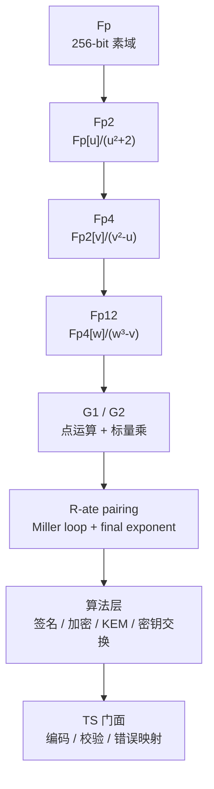

# 为什么网页端几乎看不到 SM9？我用 WebAssembly 把验签做到 8ms

> SM9 是国密里最特别的一个：它不要证书链，ID 就是公钥。理论上，这让它非常适合互联网应用——给 `alice@example.com` 发加密邮件，不需要先申请证书；验签只需要对方的 ID 和 KGC 主公钥。
>
> 但如果你在 npm 上搜“SM9 浏览器”，会发现一个尴尬的事实：SM2 / SM3 / SM4 的 JS 实现一抓一大把，SM9 的公开 Web 实现却很少。
>
> 这不是因为 SM9 不重要，而是因为它太难“在网页里跑得快”。这篇文章讲五个原因，以及我用 AssemblyScript + WebAssembly 把它做到验签 8ms 的过程。

---

## 写在前面

这个项目叫 `sm-crypto-wasm`，用 AssemblyScript 写算法核心、编译成 WebAssembly，TypeScript 做门面。之前我已经写过 SM2 / SM3 / SM4 的实现；这一篇专门讲 SM9。

性能数据的环境：**AMD Ryzen 7 7800X3D / Node 24.15 / Windows 11 / `sm-crypto-wasm` 0.7.1**，命令 `pnpm bench`。SM9 的跨进程波动比 SM2 更大，所以本文的优化前后对比都来自同一进程内的交替 A/B，绝对值只作方向参考。

先给结论：

- 网页端 SM9 稀缺，主要不是标准问题，而是 **pairing 太重 + IBC 密钥体系不适配浏览器 + 前端生态空白 + 实现门槛高 + 需求在后端**；
- 这个项目把 SM9 的签名、加密、KEM、混合加密、密钥交换都搬进了 WASM，**32 B 消息下验签 8.00ms、签名 4.11ms、加密 3.69ms、解密 5.40ms、完整密钥交换 19.6ms**，`sm9.wasm` 77KB；
- 关键优化是 **基域 Montgomery、扩域零堆分配、固定基点 comb、R-ate pairing 只累乘分子、公开配对值缓存**；
- 边界同样明确：**SM9 不是“无信任”的，它依赖 KGC；密钥交换要求双方属于同一 KGC；主私钥不应该进前端。**

先说明一句：这是一个算法实现库，不是经过商用密码产品认证的合规产品。生产环境怎么用、要不要过测评，请按你所在行业的要求来。

---

## 一、SM9 是什么：ID 即公钥

SM9 是**基于标识的密码算法**（Identity-Based Cryptography，IBC），标准是 **GM/T 0044-2016** 系列。它和 SM2 最大的区别是：

- SM2 是“证书体系”：公钥是一串点，靠 X.509 证书把“公钥”和“身份”绑起来；
- SM9 是“标识体系”：用户的标识（邮箱、手机号、设备号）直接参与公钥计算，**不需要证书链**。

SM9 里有一个角色叫 **KGC**（密钥生成中心）：

1. KGC 生成主密钥对：签名用 `ks` / `Ppubs = [ks]P2`，加密用 `ke` / `Ppube = [ke]P1`；
2. 用户把 ID 交给 KGC，KGC 用主私钥派生用户私钥：签名私钥 `ds = [ks/(H1(ID||hid)+ks)]P1`，加密私钥 `de = [ke/(H1(ID||hid)+ke)]P2`；
3. 之后加密 / 验签只需要 ID 和主公钥，签名 / 解密才需要用户私钥。

能力上，SM9 覆盖四块：

| 能力 | 标准 | 本项目入口 |
|---|---|---|
| 数字签名 | GM/T 0044.2 | `sign` / `verify` |
| 密钥交换 | GM/T 0044.3 | `createExchangeInitiator` / `createExchangeResponder` |
| 密钥封装 | GM/T 0044.4 | `kemEncrypt` / `kemDecrypt` |
| 公钥加密 | GM/T 0044.4 | `encrypt` / `decrypt` |

这里有两个特别容易踩的坑，后面还会展开：

- **签名和加密是两套独立的主密钥**：签名主公钥是 G2 上的点（128 字节），加密主公钥是 G1 上的点（64 字节），不能混用；
- **`hid` 区分用途**：签名 `0x01`、密钥交换 `0x02`、加密 `0x03`。同一个 ID 在不同用途下派生出不同的私钥。

---

## 二、为什么网页端 SM9 基本没有：五个现实原因

### 2.1 pairing 太重，纯 JS 很难做到交互可用

SM9 的核心运算不是普通椭圆曲线点乘，而是**双线性对（pairing）**。本实现用的是 **R-ate pairing**，流程包括：

1. line function（切线 / 割线）；
2. Miller loop（65 位循环参数）；
3. π1 / π2 校正；
4. final exponentiation（最终幂）。

最终幂在 **Fp12**（12 次扩域）里做，一次 pairing 是成百上千次 Fp2 / Fp4 / Fp12 乘法的堆积。纯 JS 用 BigInt 或数组模拟这些域运算，开销比 WASM 的定宽 32 位运算大得多。

我没有做过纯 JS SM9 的全面基准，所以这里不给“慢多少倍”的数字。但可以给一个参照：**本项目的 WASM 版本在 Montgomery 优化前，验签要 12.7ms；优化后 8.00ms**。如果连 WASM 都要这个量级，纯 JS 要做到“点一下按钮立刻出结果”并不容易。

这不是“写不出来”，而是“写出来不够快”。

### 2.2 IBC 的密钥体系与浏览器天然不匹配

SM9 的信任锚是 KGC。主私钥在 KGC 手里，用户私钥由 KGC 派生。这带来几个现实问题：

- 浏览器适合做**验签 / 加密**：只需要主公钥 + 对方 ID，不碰任何私钥；
- **签名 / 解密**需要用户私钥，密钥怎么下发、怎么存、怎么防导出，比 SM2 的证书体系更复杂；
- **密钥交换要求双方属于同一 KGC**（`Ppube` 相同）。本项目的 API 目前以加密主密钥 `ke` 作为输入，所以示例里双方传同一个 `ke`，各自用不同 ID；标准层面则是双方各持同一 KGC 派生的用户私钥。跨组织、跨信任域时，这个前提不成立。

换句话说，SM9 不是“无信任”的：它把证书链换成了 KGC。网页应用往往面向多租户、跨组织，和 IBC 的信任模型并不天然契合。这是 SM9 在 Web 端需求少的结构性原因。

### 2.3 WebCrypto 和前端生态没有 SM9

浏览器的 `crypto.subtle` 不提供国密算法，更没有 SM9。npm 上的 JS 国密库大多聚焦 SM2 / SM3 / SM4；SM9 的参考实现主要在 C / Java 生态（GmSSL、BouncyCastle），部署在服务端、网关或专网里。

我没有做过 npm 全量统计，所以不说“完全没有”；更准确的说法是：**能直接在浏览器里用、覆盖签名/加密/KEM/密钥交换、并且和标准向量对得上的 SM9 实现，很少。**

### 2.4 实现门槛高：不是“会椭圆曲线”就能写

SM9 的实现难度比 SM2 高不少：

- **塔式扩域**：Fp2 → Fp4 → Fp12，每层有自己的不可约多项式和乘法规则；
- **pairing**：line function、Miller loop、π1 / π2 校正、final exponent，每一步都要和标准 / 参考实现对齐；
- **哈希与编码**：H1 / H2 是 40 字节哈希再模 `n-1` 加 1；KDF 是 SM3 计数器模式；C1 是 65 字节未压缩点，KDF 输入却只取 x||y 64 字节；
- **KAT 对拍**：SM9 的输出对字节序、hid、C1/C3 布局极其敏感，差一个字节就全错。没有可靠的交叉对拍，很容易“能跑但结果不对”。

这也是为什么很多团队宁愿在服务端用 GmSSL，也不愿意在前端重写一套。

### 2.5 需求场景在后端 / 专网，不在网页

SM9 的典型落地是邮件、IoT、跨域认证、政务专网——这些场景的信任锚和密钥管理本来就在服务端。Web 前端更常见的国密改造是 SM2 签名 / SM4 报文加密。

需求少 → 实现少 → 生态更少，形成一个循环。网页端 SM9 的空白，本质上是这个循环的结果。

---

## 三、这个项目改变了什么

### 3.1 不是 demo，是全套能力

很多 SM9 示例只做到“签个名”。这个项目把标准里的主要能力都实现了：

- 签名 / 验签；
- 加密 / 解密；
- KEM 封装 / 解封装；
- 混合加密（KEM + SM4-GCM）；
- 密钥交换（GM/T 0044.3，含 S_A / S_B 确认值）；
- 主密钥对生成、主公钥派生、用户公钥派生；
- PKCS#8 / SPKI PEM 编码，算法 OID `1.2.156.10197.1.100`。

这意味着浏览器端不仅能“验一个 SM9 签名”，还能做完整的标识密码应用：用 ID 加密、用 KEM 协商会话密钥、用混合加密传大消息、在同一 KGC 内做密钥交换。

### 3.2 性能：从“不可交互”到“可用”

同机、同参数的实测（单位：ms / µs）：

| 操作 | 优化后 | 优化前 | 说明 |
|---|---:|---:|---|
| 签名 32 B | 4.11 ms | 6.65 ms | pairing + G1 标量乘 + Fp12 幂 |
| 验签 32 B | 8.00 ms | 12.7 ms | 1 次 pairing + 1 次缓存配对值（首次 miss 时 2 次） |
| 加密 32 B | 3.69 ms | 5.51 ms | pairing + G1 标量乘 + Fp12 幂 |
| 解密 32 B | 5.40 ms | 7.49 ms | pairing 主导 |
| KEM 封装 / 解封装 | 3.42 / 4.92 ms | 4.90 / 7.50 ms | 32 B 会话密钥 |
| 密钥交换（完整 A↔B） | 19.6 ms | 28.0 ms | 双方各若干 pairing |
| 主密钥对生成（签名 / 加密） | 2.07 / 1.73 ms | — | |
| 主公钥派生（签名 / 加密） | 97.1 / 49.1 µs | — | 固定基点 comb |
| 用户公钥派生 | 563 µs | — | G2 标量乘 |
| hybrid 加密 / 解密 10 KB | 3.21 / 4.77 ms | — | KEM + SM4-GCM |

怎么判断“8ms 验签”算不算可用？

- 一次登录、一次报文验签，8ms 对交互几乎没有影响；
- 加密 3.69ms、解密 5.40ms，单条消息可以接受；
- 密钥交换 19.6ms，一次握手可以接受，但不适合高频调用；
- 批量验签 / 高频加密仍然应该走服务端或做缓存。

还要说清楚：**这是 x86 桌面 + Node 24 的数据，不是低端手机的数据。** 小程序、低端安卓上的绝对耗时会更长；我没有做全机型评测，所以不把 8ms 当成所有设备的承诺。

包体积方面，`sm9.wasm` 是 **77KB**，按算法分包、按需加载。只做 SM2 / SM4 的页面不会下载它；小程序可以在准备阶段只保留用到的算法。

### 3.3 跨端：同一份 API

`ensureLoaded()` 之后，签名 / 验签 / 加密 / 解密都是同步调用：

```ts
import { sm9 } from 'sm-crypto-wasm';

await sm9.ensureLoaded();
const kp = await sm9.generateKeyPair({ id: 'alice@example.com' });
const sig = sm9.sign(kp.masterPrivatePem, 'alice@example.com', '616263');
sm9.verify(kp.masterPublicPem, 'alice@example.com', '616263', sig);
```

Node、浏览器、Web Worker 走同一套门面。微信小程序需要 `WXWebAssembly`（基础库 2.13.0+）和 `wx.getRandomValues`（2.15.0+）；hybrid 还会用到 `sm4.wasm`，首次调用前要一起 `ensureLoaded()`。

---

## 四、实现总览：从 Fp 到 pairing 的塔

SM9 的实现分成七层：



代码量大致是：

- `src/sm9/assembly/`：约 **6400 行**（Fp 469、Fp2 601、Fp4 551、Fp12 837、point 1046、pairing 676、sm9 1098、index 1081）；
- `src/sm9/` 的 TS 门面：约 **1900 行**（core / input / index / kem / hybrid）。

每层的职责：

- **Fp**：SM9 的 256 位素域，所有元素在 Montgomery 域里；
- **Fp2 / Fp4 / Fp12**：塔式扩域，pairing 的工作域；
- **G1 / G2**：曲线点运算，Jacobian 坐标 + wNAF / comb；
- **pairing**：R-ate，输出 Fp12 里的配对值；
- **算法层**：H1 / H2 / KDF、签名、加密、KEM、密钥交换；
- **TS 门面**：hex / PEM / `Uint8Array` 嗅探、长度校验、`SmCryptoError` 映射、`ensureLoaded`。

---

## 五、关键实现 1：基域 Montgomery，单次模乘 179 → 98ns

SM9 的基域是 BN 曲线：

```
p = b6400000 02a3a6f1 d603ab4f f58ec745 21f2934b 1a7aeedb e56f9b27 e351457d
n = b6400000 02a3a6f1 d603ab4f f58ec744 49f2934b 18ea8bee e56ee19c d69ecf25
```

`p` 不是伪 Mersenne 形状，做不了 SM2 那种 Solinas 展开；原来走通用 Barrett 归约，一次 512→256 归约大约要 **217 次 32×32 乘法**。换成 CIOS Montgomery 后只要 **128 次**，单次模乘从 **179ns 降到 98ns**。

做法是**全链统一 Montgomery 域**：

- `R = 2²⁵⁶`，`n0' = -p⁻¹ mod 2³² = 0x2f2ee42b`；
- Fp 元素内部一律是 `a·R mod p`；
- 只有和外部字节、模块常量打交道时才做 `fpToMont` / `fpFromMont`；
- 如果每次乘法都临时转换进/出 Montgomery，实测反而要 195.6ns，比原来还慢。所以“全链统一、只在边界转换”是这条优化的前提。

这里有两个编译器抓不到的坑，值得单独记：

- **`fpInv` 少补一个 R**：`modInv(a·R) = a⁻¹·R⁻¹`，要补回 `a⁻¹·R`，而且必须用标准域乘法乘 `R²`；用 `montMul` 会自带 `·R⁻¹`，正好把要补的 `R` 又消掉。症状是所有点坐标掉出曲线。
- **`FE_A2` / `FE_A3` 是指数、不是元素**：它们和 `ALPHA1..5` 长得像，但喂给 `fp12Pow` 时必须保持标准域整数，转成 Montgomery 会让最终幂整条错掉。

结果：单次模乘 1.82×，端到端签名 / 验签 / 加密 / 解密 / KEM / 密钥交换普遍 **1.6–1.8×**。这说明 SM9 的耗时确实由基域模乘主导。

---

## 六、关键实现 2：扩域塔与零堆分配

SM9 的扩域是塔式构造：

- **Fp2 = Fp[u]/(u² + 2)**，即 `u² = -2`；
- **Fp4 = Fp2[v]/(v² − u)**；
- **Fp12 = Fp4[w]/(w³ − v)**。

每个元素用**连续裸指针**表示：Fp2 64 字节、Fp4 128 字节、Fp12 384 字节。每个算子有两层：

- `fp*To(out, …)`：直接写调用者的 `out`，内部只用模块级 scratch，**零堆分配**；
- `fp*(…)`：薄包装，从 arena 分配 `out` 再调 `To` 版本。

扩域链（Fp4 / Fp12 / 点运算）内部互相调用 `To` 版本，所以 pairing 热路径上几乎没有逐次分配。这个设计对 SM9 特别重要：一次 pairing 要做大量 Fp12 乘法，如果每次都 `new` 一个 384 字节的对象，GC 和分配开销会把域运算的收益吃掉。

乘法本身用 Karatsuba：

- Fp2 乘法：4 次 Fp 乘法 → 3 次；
- Fp4 乘法：4 次 Fp2 乘法 → 3 次；
- Fp12 的 line 乘：利用稀疏结构，15 次 Fp2 乘法，通用 Fp12 乘法要 18 次。

`fp12Pow` 也不是简单的 square-and-multiply：

- 指数先转 **NAF**（非邻接形式），平均非零位从 ~128 降到 ~85，乘法次数降约 1/3；
- 平方用 **cyclotomic 专用版**（`fp12SqrCyc`），前提是元素已经在 `G_{Φ6(p²)}` 子群里；
- 本实现的所有调用点都满足这个前提：hard part 的中间值、配对值 `e(...)`，子群对乘法 / 平方 / Frobenius 封闭。

---

## 七、关键实现 3：G1 / G2 与固定基点 comb

G1 是基域上的点（64 字节），G2 是 twist 曲线上的点（128 字节）。点运算用 Jacobian 坐标，标量乘用 **wNAF（w = 5）**。

但 SM9 里有大量“标量 × 固定基点”的运算：签名主公钥 `[ks]P2`、加密主公钥 `[ke]P1`、用户私钥 `ds` / `de` 的派生等。固定基点是可以用 **comb 预计算**的：

- `COMB_W = 5`，`COMB_D = 52`（`ceil(256/5)`）；
- 表首次使用时惰性构造并缓存；
- G2 单次标量乘从 **wNAF 1058µs 降到 comb 415µs（2.5×）**；
- 端到端签名 / 验签 / 加密 / 解密提升 **6–13%**；
- 代价是首次操作多 **1.09ms** 建表。

这是一个典型的“用空间换时间、并且只对固定基点成立”的优化。任意点的标量乘仍然走 wNAF；comb 表只用在基点固定的路径上。

---

## 八、关键实现 4：R-ate pairing

pairing 是 SM9 性能的核心，也是最难对拍的部分。

### 8.1 line function 与 Miller loop

R-ate pairing 的主体是 Miller loop。每一轮要做：

- 对当前点 `T` 求切线（tangent），得到一个 line function；
- 把 line function 乘进累积值 `f`；
- 倍点 `T`；
- 如果循环参数的当前位是 1，做割线（secant）并加点。

本实现的循环参数是一个 **65 位**的二进制串（`ABITS`），Miller loop 结束后还要做 `π1` / `π2` 两次校正，再进入最终幂。

### 8.2 只累乘分子：每轮少一次 Fp12 平方和乘法

line function 的分母恒为 `b1v · v`（`b1v ∈ Fp2`，`v` 是 Fp4 生成元）。而

```
v^((p⁶−1)(p²+1)) = (v^(p²−1))^(p²+1) = (−1)^(p²+1) = 1
```

`b1v` 同理。也就是说，**分母会被 final exponent 的 easy part 整个消掉**。所以 Miller loop 只累乘分子，不需要维护分母。

GmSSL 的实现保留分子 / 分母两路；本实现省掉分母后，每次迭代少一次 `fp12Sqr` 和一次 `fp12Mul`。这不是“近似”，而是利用 6 次 twist 曲线的分母消除性质。

### 8.3 final exponent

最终幂分两段：

- **easy part**：`f^((p⁶−1)(p²+1))`，用 Frobenius + 逆元；
- **hard part**：用预计算的 Frobenius 系数 `ALPHA1..5` 和指数常量 `FE_A2` / `FE_A3` 做幂运算。

最终幂里还用了两处优化：

- `fp12Pow` 的 NAF + cyclotomic 平方；
- line 乘的稀疏结构（15 次 Fp2 乘法，而不是 18 次）。

### 8.4 公开配对值缓存：4 槽，不含秘密

SM9 里有两个配对值只取决于主公钥：

- `e(Ppubs, P1)`：验签用；
- `e(P2, Ppube)`：加密 / KEM 用。

它们和消息、用户无关，但各占一整次 pairing。本实现按主公钥仿射坐标做了 **4 槽直接映射缓存**：

- 缓存的是公开点的配对结果，不含任何秘密；
- 命中只省时间，不改变安全边界；
- 4 槽对“1 个 KGC + 少数根密钥”的典型场景足够；冲突时覆盖该槽。

对“同一主公钥反复验签 / 加密”的应用，这个缓存比任何微优化都直接。

---

## 九、关键实现 5：算法层

### 9.1 H1 / H2 / KDF

SM9 的哈希不是直接 SM3 一次：

- `H1(ID||hid, n)`：`SM3(0x01||ID||hid||1) || SM3(0x01||ID||hid||2)`，取前 40 字节，模 `n-1` 再加 1；
- `H2(Z, n)`：`SM3(0x02||Z||1) || SM3(0x02||Z||2)`，同样取 40 字节再模；
- `KDF(Z, klen)`：`SM3(Z||ct)`，`ct` 从 1 开始的大端计数器，**没有前缀**。

这些细节决定了能不能和 GmSSL 对拍。尤其是 `H1` 里的 `hid`，签名 / 密钥交换 / 加密分别是 `0x01` / `0x02` / `0x03`。

### 9.2 签名与验签

签名（`GM/T 0044.2`）：

1. `g = e(Ppubs, P1)`；
2. `w = g^r`；
3. `h = H2(M || w, n)`；
4. `l = (r − h) mod n`；
5. `S = [l]ds`；
6. 输出 `h || Sx || Sy`，共 96 字节。

验签：

1. `g = e(Ppubs, P1)`，`t = g^h`；
2. `h1 = H1(ID || hid, n)`；
3. `P = [h1]P2 + Ppubs`；
4. `u = e(P, S)`；
5. `w = u · t`；
6. `h2 = H2(M || w, n)`，检查 `h2 == h`。

代码里 `signG(ppubs)` 就是第 1 步的缓存版本；`sm9Verify` 里的 `P2` 是 `[h1]P2 + Ppubs`，`u = sm9Pairing(g2ToAffine(P2), S)`，`w = u * t`。

### 9.3 加密与解密

加密（`GM/T 0044.4`）：

1. `Q = [H1(ID || hid)]P1 + Ppube`；
2. `C1 = [r]Q`；
3. `g = e(Ppube, P2)`，`w = g^r`；
4. `K = KDF(C1.x || C1.y || w || ID, msgLen + 32)`；
5. `C2 = M ⊕ K[0..msgLen]`；
6. `C3 = HMAC-SM3(K[msgLen..msgLen+32], C2)`；
7. 输出 `C1(65B) || C3(32B) || C2(msgLen)`。

解密：

1. `w = e(de, C1)`；
2. 同样的 KDF；
3. 重算 `C3` 并比较；
4. `M = C2 ⊕ K[0..msgLen]`。

这里有一个必须写清楚的实现细节：**C3 的计算要和 GmSSL 对齐**。GmSSL 用的是 `HMAC-SM3(K2, C2)`（对密文做 HMAC），而不是直接 `SM3(C2 || K2)`。本实现按 GmSSL 的约定来；和别的 SM9 实现对接时，这一处最容易对不上。

另一个细节：`C1` 是 65 字节的未压缩点 `04 || x || y`，但本实现按 GmSSL 的约定，KDF 输入只取 `x || y` 64 字节。少一个字节都会导致 K 不同。

### 9.4 KEM

封装：

1. `Q = [H1(ID || hid)]P1 + Ppube`；
2. `C1 = [r]Q`；
3. `w = e(Ppube, P2)^r`；
4. `K = KDF(C1.x || C1.y || w || ID, klen)`。

解封装：

1. `w = e(de, C1)`；
2. `K = KDF(C1.x || C1.y || w || ID, klen)`。

KEM 的封装结果只有 65 字节的 `C1`，没有 C3/HMAC。所以完整性要靠上层：本项目的 `hybridEncrypt` 把 KEM 和 SM4-GCM 组合起来，用 GCM tag 兜底；错误的 ID / 主公钥最终会表现为 GCM 解密失败。

### 9.5 密钥交换

密钥交换（`GM/T 0044.3`）要求双方属于**同一 KGC**（`Ppube` 相同）。本项目的门面目前以加密主密钥 `ke` 作为输入，示例里双方传同一个 `ke`，各自用不同 ID。流程：

1. 发起方 A 生成临时点 `RA = [rA](H1(IDB || hid) P1 + Ppube)`；
2. 响应方 B 生成临时点 `RB = [rB](H1(IDA || hid) P1 + Ppube)`；
3. 双方计算：
   - `E1 = e(P2, Ppube)^r`；
   - `E2 = e(de, peerR)`；
   - `G3 = E2^r`；
4. 发起方 `G1 = E1, G2 = E2`；响应方 `G1 = E2, G2 = E1`；
5. `K = KDF(IDA || IDB || RA || RB || G1 || G2 || G3, klen)`；
6. 确认值 `S = SM3(prefix || G1 || SM3(G2 || G3 || IDA || IDB || RA || RB))`，发起方 `prefix = 0x83`，响应方 `0x82`。

本实现把 S_A / S_B 和共享密钥一次算完（`sm9ExchAll`），避免重复 pairing；确认值比较用常量时间实现，不用 `===`。

### 9.6 一个内存越界回归

SM9 加密的密文长度是 `65 + 32 + msgLen`。早期门面层把输出缓冲硬编码成 `alloc(4096)`，明文超过 3999 字节就会写越界，破坏 WASM 堆，几轮后抛 `RuntimeError: memory access out of bounds`。

这是一个很典型的“算法对了，工程错了”的问题。现在按实际长度分配，并把容量传给 WASM 侧校验；测试里用 10KB 消息循环 8 轮，专门覆盖这个回归。

### 9.7 门面层：密钥编码与错误边界

算法层之上还有一层薄门面，负责把“字节”变成“可用的 API”：

- **密钥编码**：私钥走 PKCS#8、公钥走 SPKI，算法 OID 是 `1.2.156.10197.1.100`；同时接受裸 hex / `Uint8Array` / PEM。
- **异步边界**：`ensureLoaded()` 之前所有同步 API 都会报“未初始化”；加载是 memoize 的，并发调用共用同一个 Promise。
- **参数区分**：`verify` / `encrypt` 可以靠长度区分“主公钥”和“主私钥”；`sign` / `decrypt` 必须给私钥。签名主公钥 128 字节，加密主公钥 64 字节，签名私钥 64 字节，加密私钥 128 字节。
- **错误分层**：密钥格式错误抛 `InvalidKeyError`，密文结构错误抛 `CiphertextError`，认证失败抛 `DecryptionError`；`safeMode` 只把密文支错误转成 `null`，参数类型错误仍然抛。
- **标量范围**：主私钥必须在 `[1, n-1]`，0、`n`、`2²⁵⁶−1` 都会被拒绝。

这些看起来是“胶水”，但它们是 Web 端能不能稳定用的关键。算法对了、API 把错误吞了，线上一样会出问题。

---

## 十、把优化收拢成一张表

| 优化 | 位置 | 收益 |
|---|---|---|
| Montgomery 域 | Fp | 单次模乘 179 → 98ns，端到端 1.6–1.8× |
| 固定基点 comb | G1 / G2 | G2 标量乘 1058 → 415µs，端到端 6–13% |
| Miller loop 省分母 | pairing | 每轮少一次 `fp12Sqr` + `fp12Mul` |
| NAF + cyclotomic 平方 | `fp12Pow` | 乘法次数约降 1/3 |
| 稀疏 line 乘 | `fp12MulLine` | 15 次 Fp2 乘法，通用要 18 次 |
| 公开配对值缓存 | `signG` / `encG` | 同一主公钥省一次 pairing |
| `To` 算子 + 模块级 scratch | 扩域 | 热路径零堆分配 |

这些优化有一个共同点：**都作用在“每次调用都会重复发生”的地方**。如果只做一次的操作（比如建 comb 表），就不值得为它引入太多复杂度。

---

## 十一、性能是怎么测的：同进程 A/B，别信跨进程绝对值

SM9 的测量比 SM2 / SM3 更容易骗人。

同一台机器上，跨进程的波动可以达到 **4–11×**：同一个 `g2MulGOut`，两次运行分别测出 98µs 和 425µs。如果拿两次独立运行的绝对值做前后对比，结论基本等于抛硬币。

所以本文的优化前后数字统一用：**同进程、同一时段、交替 A/B**。两个版本装进同一个进程，轮流跑，各取 min；两组输入由各自实例生成，并逐字节比对输出。

还有一个细节：bench 里的一些标量是故意用小值的。comb 对小标量有固定开销，反而可能略慢，会掩盖固定基点标量乘的收益。看 benchmark 时要知道它测的是什么负载。

你要复现：

```bash
pnpm install
pnpm build
pnpm bench
```

---

## 十二、正确性怎么保证

SM9 的“看起来能跑”和“结果正确”之间，差的是逐字节对拍。

本项目的 SM9 测试分几层：

1. **GmSSL KAT**：用 GmSSL C 官方 `tests/sm9test.c` 附录 A 的参数，对签名、加密、KEM、密钥交换逐字节对拍；
2. **扩域等价性**：Fp2 / Fp4 / Fp12 用 BigInt 按域的定义独立展开（不照抄实现公式），和 WASM 输出逐字节比较；
3. **cyclotomic 平方自测**：随机生成 Fp12，送入子群，比较 `fp12Sqr` 和 `fp12SqrCyc`；
4. **失败路径**：错误 ID、错误主私钥、篡改密文 / 确认值、密钥范围越界、PEM OID 不匹配；
5. **长消息回归**：10KB 明文循环加解密，覆盖密文缓冲越界。

目前 `tests/sm9/` 下有 9 个测试文件、50 个用例（按 `it` 统计）。这个数量不算多，但覆盖的是最容易错的边界，而不是“每个函数都写一遍”。

---

## 十三、网页端 SM9 的边界：什么时候该用，什么时候不该

### 适合放在前端

- **验签**：只需要主公钥 + 签名者 ID；
- **加密**：只需要接收方主公钥 + 接收方 ID；
- **hybrid**：发送方只需要主公钥，适合大消息；
- **同一 KGC 内的密钥交换**：双方属于同一 KGC（`Ppube` 相同），各自用 ID；本项目 API 以 `ke` 为输入。

### 不建议放在前端

- **主私钥**：KGC 的主私钥不应该进浏览器；
- **跨 KGC 的密钥交换**：双方不属于同一 KGC 时，协议前提不成立；
- **证书链 / CRL / OCSP**：SM9 本身不是证书体系，这个库也不做 PKI 路径校验；
- **需要商用密码产品认证的场景**：本库是算法实现，不替代测评和合规流程；
- **极低端设备 / 高频批量操作**：8ms 是桌面数据；低端机更慢，批量场景应该走服务端或缓存。

密钥管理上，前端能做的是“持有用户私钥并尽量不导出”：例如在受控 Worker 内短暂持有、页面卸载时清理。需要注意，本库的签名 / 解密 API 接收的是私钥字节或 PEM，不是 WebCrypto 的 `CryptoKey`；非导出密钥的封装需要你在上层自己做，本库不替你解决。

---

## 十四、上手：签名、加密、KEM、密钥交换

### 签名 / 验签

```ts
import { sm9 } from 'sm-crypto-wasm';

await sm9.ensureLoaded();
const id = 'alice@example.com';
const kp = await sm9.generateKeyPair({ id });

const sig = sm9.sign(kp.masterPrivatePem, id, '616263'); // 96 字节，192 hex
sm9.verify(kp.masterPublicPem, id, '616263', sig);        // true
```

### 加密 / 解密

```ts
const encKp = await sm9.generateKeyPair({ id, purpose: 'enc' });
const ct = sm9.encrypt(encKp.masterPublicPem, id, '616263');
sm9.decrypt(encKp.masterPrivatePem, id, ct); // '616263'
```

### KEM / 混合加密

```ts
const { key, encapsulation } = sm9.kemEncrypt(encKp.masterPrivatePem, id, 32);
sm9.kemDecrypt(encKp.masterPrivatePem, id, encapsulation, 32); // === key

const sealed = sm9.hybridEncrypt(encKp.masterPublicPem, id, '616263');
sm9.hybridDecrypt(encKp.masterPrivatePem, id, sealed);         // '616263'
```

注意：`kemEncrypt` 的第一个参数是**加密主私钥**，因为它要派生 `Ppube`；`hybridEncrypt` 的第一个参数可以是主公钥（发送方的典型形态）。hybrid 同时用到 `sm9.wasm` 和 `sm4.wasm`，首次调用前要一起 `ensureLoaded()`。

### 密钥交换

```ts
const a = await sm9.createExchangeInitiator(encKp.masterPrivatePem, 'alice', 'bob');
const b = await sm9.createExchangeResponder(encKp.masterPrivatePem, 'bob', 'alice');
const r1 = a.initiate();
const r2 = b.respond(r1);
const r3 = a.confirm(r2);
const ka = a.getSharedKey(r2);
const kb = b.getSharedKey(r3); // ka === kb
```

双方必须属于同一 KGC（`Ppube` 相同）；本项目的 API 以 `ke` 为输入，所以示例里传同一个 `ke`。如果 A 和 B 属于不同 KGC，这个协议不能直接跑。

### 小程序

小程序用 `WXWebAssembly` 加载 `sm9.wasm`，用 `wx.getRandomValues` 提供随机数；基础库要求 2.13.0+ / 2.15.0+。仓库里的 `examples/wechat-miniprogram` 有可直接导入的示例，`pnpm example:wechat:prepare --algos sm9` 可以只保留 SM9 及其依赖。

---

## 十五、总结：网页端 SM9 的空白，是工程问题

回到开头的问题：为什么网页端几乎看不到 SM9？

不是标准不好，也不是没人需要，而是五件事叠在一起：

1. pairing 计算量大，纯 JS 很难做到交互可用；
2. IBC 依赖 KGC，跨组织、跨信任域时前提不成立；
3. WebCrypto 和前端生态没有 SM9；
4. 实现门槛高，扩域、pairing、编码任何一处错了都“能跑但不对”；
5. 需求场景在服务端 / 专网，不在网页。

这个项目做的事情，是把第 1 和第 4 条尽量压下去：用 AssemblyScript → WASM 把 hotspot 跑快，用 GmSSL KAT 和 BigInt 扩域对拍把正确性守住，用一套跨端门面把 API 统一。结果是：**验签 8.00ms、签名 4.11ms、加密 3.69ms、解密 5.40ms、完整密钥交换 19.6ms，`sm9.wasm` 77KB**。

它没有改变 SM9 的信任模型，也没有让主私钥适合放进浏览器。它只是让“同一 KGC 信任域内的 Web 应用”可以比较自然地把 SM9 用起来。

三条可复用的经验：

1. **基域表示决定上限**：SM9 的 `p` 不是伪 Mersenne，Barrett → Montgomery 带来接近 2× 的单次模乘收益；但必须全链统一，边界转换一次。
2. **扩域热路径要零分配**：pairing 是 Fp12 乘法的堆积，`To` 算子 + 模块级 scratch 比“少写几行代码”重要得多。
3. **固定基点和公开配对值都值得缓存**：comb 表、`e(Ppubs,P1)`、`e(P2,Ppube)`，都是“只取决于公开输入”的量，缓存它们不改变安全边界。

完整文档和各算法页面在 [jktantan.github.io/sm-crypto-wasm](https://jktantan.github.io/sm-crypto-wasm/)，源码在 [GitHub](https://github.com/jktantan/sm-crypto-wasm)，npm 包名 `sm-crypto-wasm`。SM9 的性能实验记录在仓库的 `docs/performance-ceiling.md`，欢迎拿自己的负载复现、质疑、提 issue。
